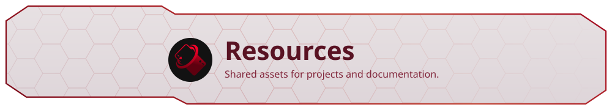
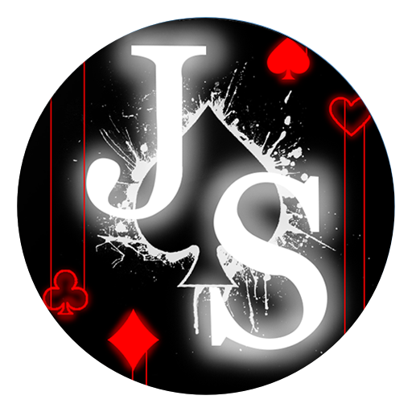
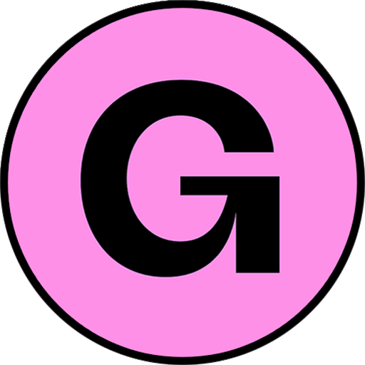

<h1 align="center" id="resources">
<picture>
<source media="(prefers-color-scheme: dark)" srcset=".github/readme/banner-dark.svg">

</picture>
</h1>

<a href="https://github.com/JustSleightly/Resources/commits/main"><picture><source media="(prefers-color-scheme: dark)" srcset="https://shieldcn.dev/github/last-commit/JustSleightly/Resources.svg?variant=outline&amp;font=space-grotesk&amp;split=false&amp;size=xs&amp;mode=dark&amp;height=24&amp;gradient=2C171E%2C2C171E&amp;color=CA8F9F&amp;labelTextColor=E9B7C1&amp;valueColor=FAFAFA&amp;logoColor=DF8395&amp;label=Updated&amp;logo=data%3Aimage%2Fsvg%2Bxml%3Bbase64%2CPHN2ZyB4bWxucz0iaHR0cDovL3d3dy53My5vcmcvMjAwMC9zdmciIHZpZXdCb3g9IjAgMCAxNCAxNCI%2BPHBhdGggZmlsbD0ibm9uZSIgc3Ryb2tlPSJjdXJyZW50Q29sb3IiIHN0cm9rZS13aWR0aD0iMS4yNSIgc3Ryb2tlLWxpbmVjYXA9InJvdW5kIiBzdHJva2UtbGluZWpvaW49InJvdW5kIiBkPSJNMS41IDUuOEE1LjYgNS42IDAgMSAxIDIuNSAxMC42TTEuNSAyLjNWNS44SDVNNy4xIDMuN1Y3LjNMOS42IDguNyIvPjwvc3ZnPg%3D%3D"></picture></a>
<a href="https://discord.sleightly.dev"><picture><source media="(prefers-color-scheme: dark)" srcset="https://shieldcn.dev/discord/members/dakrwvjDzR.svg?variant=outline&amp;font=space-grotesk&amp;split=false&amp;size=xs&amp;mode=dark&amp;height=24&amp;gradient=2C171E%2C2C171E&amp;color=CA8F9F&amp;labelTextColor=E9B7C1&amp;valueColor=FAFAFA&amp;logoColor=DF8395&amp;label=Discord"></picture></a>
<a href="https://x.com/SleightlyDev"><picture><source media="(prefers-color-scheme: dark)" srcset="Badges/ShieldCN/x-dark.svg"></picture></a>

Created by <a href="https://github.com/JustSleightly"><strong>JustSleightly</strong></a>

Browse shared badges, icons, images, and reference documents used across JustSleightly projects. Link to the assets you need or copy them into your project.

<table align="center">
<tr>
<td align="center" width="300"><strong>JustSleightly</strong></td>
</tr>
<tr>
<td align="center">

</td>
</tr>
</table>
